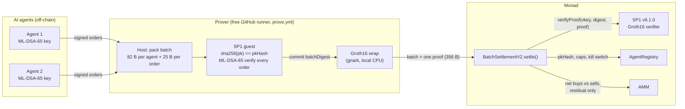
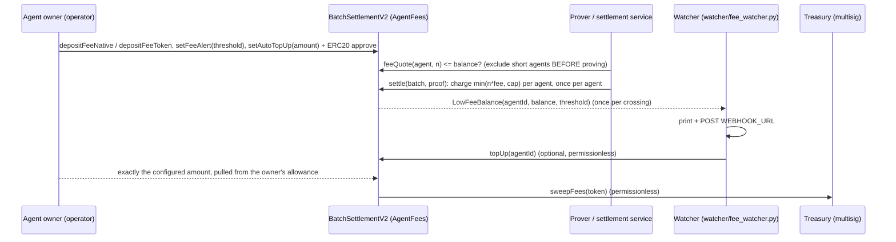

# pq-agent-batch

[](https://github.com/EmpowerTours/pq-agent-batch/actions/workflows/ci.yml)
[](LICENSE)

**Post-quantum AI-agent orders, settled in batches on Monad for about 13.8k gas each.** Each AI agent signs its trade orders with **ML-DSA-65** (FIPS 204, post-quantum). An **SP1** zkVM guest checks every signature in a batch and outputs one 32-byte digest. That run is wrapped into a single **Groth16** proof. On Monad, `BatchSettlementV2` verifies the one proof, applies the agent registry (keys, caps, nonces, kill switch), nets buys against sells, and sends only the residual to an AMM. A 100-order batch settled on a Monad devnet for **13,799 gas per order**. Verifying one ML-DSA-signed order on its own on Monad mainnet costs **1,192,307 gas**, so batching is **86× cheaper**. The proofs were made on free GitHub runners with no prover network.

It builds on [EmpowerTours/quantum-portfolio](https://github.com/EmpowerTours/quantum-portfolio), which proves one order at a time and is live on Monad mainnet. This repo is the batched version.

> **Status: research prototype, devnet only, not audited.** All keys in this repo are deterministic **TEST** keys derived from public seeds. See [Security notes and limitations](#security-notes-and-known-limitations).

## Architecture



- **Signed message** (133 B per order): order tag, chain id, settlement address, agent id, nonce, expiry, model hash, order. A signature cannot be replayed on another chain, against another contract, at another nonce, or for another model.
- **Public output of the proof:** `batchDigest = keccak256(abi.encode(BATCH_TAG_V2, chainid, settlement, batchId, keccak256(batch)))`. The contract recomputes it from calldata, so any change to the batch, the batch id, the chain or the contract address fails verification.
- **Replay protection:** per-agent nonces. Each agent group must start above that agent's `lastNonce`, and settling advances it.

### Batch format (v2)
```
batch := group+                                   (no trailing bytes)
group := agentId u32 | count u16 | firstNonce u64 | expiry u32 | pkHash b32 | modelHash b32   (82 B)
         order[count]
order := flags u8 (bit0 = buyBase) | amountIn u96 | minAmountOut u96                          (25 B)
signed msg (133 B) = keccak("EmpowerTours.AgentOrder.v2") | chainid u64 | settlement | agentId u32 |
                     nonce u64 (= firstNonce + j) | expiry u32 | modelHash | order
digest = keccak256(abi.encode(keccak("EmpowerTours.AgentBatch.v2"), chainid, settlement, batchId, keccak256(batch)))
```

## Results

### Live settlement of real proofs (local Monad devnet "Solonet", chain 20143)
Two real SP1 Groth16 proofs from the `prove` workflow were settled one after the other on one deployment, using the **real** SP1 v6.1.0 Groth16 verifier. Each tx was sent with gas limit = `eth_estimateGas`, because Monad charges the gas limit. Raw data: [`results/solonet/settlements.json`](results/solonet/settlements.json).

| Batch | Orders | Gas (charged) | Gas per order | vs one mainnet attestation per order | Tx (Solonet) |
|---|---|---|---|---|---|
| 1 | 10 | 1,315,406 | 131,541 | 9.1× cheaper | `0x283d9402524657fd60ede01e33ec7a5993c9f1ea2132b98caf382a5549256431` |
| 2 | 100 | 1,379,924 | **13,799** | **86.4× cheaper** | `0x7c4f54d8f09abd5d9e4fa4b50aeccb4d72d3c9cb7787b04a0e5c10c6bb740c28` |

The baseline is 1,192,307 gas: the gas used by quantum-portfolio's Groth16 attestation of **one** ML-DSA-65 signed order on Monad mainnet ([`0x4cc8290b…c5e4`](https://monadscan.com/tx/0x4cc8290b5338b388750b7ea3b00ae47ebd0af86a9a5d38f1096e1337f70dc5e4)). That figure covers the proof check only, not the swap.

Where the gas goes at N=100 (from `callTracer` on the live tx):

| Component | Gas | Share |
|---|---|---|
| Groth16 proof check (SP1 verifier call) | 1,063,693 | 77.1% |
| Settlement logic (decode, netting, nonces, balances; includes the ~12k slack in `eth_estimateGas`) | 141,206 | 10.2% |
| AMM (one residual swap + token transfer) | 91,611 | 6.6% |
| Registry reads (2 agents) | 34,602 | 2.5% |
| Calldata (3,236 B) | 27,812 | 2.0% |
| Intrinsic | 21,000 | 1.5% |

Everything except the proof check comes to **3,162 gas per order** at N=100. The proof check is a fixed cost, so the cost per order keeps falling as N grows.

### Proving on free GitHub runners
`SP1_PROVER=cpu` with a local gnark Groth16 wrap, on `ubuntu-latest` (16 GB RAM, plus 32 GB swap added by the workflow). No prover network and no credentials. Raw data: [`results/proving.json`](results/proving.json).

| N | Prove wall time | Peak RSS | Run |
|---|---|---|---|
| 10 | 46 min 50 s | 14.70 GiB | [38787797233](https://github.com/EmpowerTours/pq-agent-batch/actions/runs/38787797233) |
| 100 | 2 h 45 min | 14.85 GiB | [38787815547](https://github.com/EmpowerTours/pq-agent-batch/actions/runs/38787815547) |

Guest cost (SP1 6.3.1 executor): about **1.19M RISC-V cycles per order** at N ≥ 100.

### History: stand-in phase
Before any real batch proof existed, gas was measured with a **stand-in** verifier. It called the real SP1 Groth16 verifier bytecode with a real single-order proof from quantum-portfolio, so the pairing cost was the same, but it did **not** bind the batch. Measured on Solonet:

| N | v1 (ABI-encoded) gas per order | v2 (packed) gas per order, stand-in |
|---|---|---|
| 10 | 141,348 | 132,689 |
| 100 | 18,874 | 13,914 |
| 500 | 7,987 | 3,356 |

The real N=100 result (13,799) came in slightly below the stand-in (13,914), because the real verifier call costs 1,063,693 gas against 1,075,055 for the stand-in. The v1 contract and the stand-in harness have since been removed. They remain in git history up to commit [`361d5ec`](https://github.com/EmpowerTours/pq-agent-batch/tree/361d5ec). All raw rows are kept in [`results/history/gas-measurements.jsonl`](results/history/gas-measurements.jsonl). The values above 100 orders come from the stand-in phase and have not been re-measured with real proofs.

## Payments: prepaid fees, registration, low-balance alerts

Each agent pays for the actions it settles out of a **prepaid fee balance** held by the settlement contract (`contracts/src/AgentFees.sol`, which `BatchSettlementV2` inherits). Fees are handled only in the contract. The proved batch format and the digest are unchanged, and the committed real proofs still verify with fees switched on (`test/RealGroth16Fees.t.sol`).



| | How it works |
|---|---|
| **Fee balance** | One fee account per agent, kept in one storage slot. It holds **native MON** (token 0) or one admin-listed **ERC20** such as USDC (tokens 1–3). Anyone can deposit for an agent. Only the owner (the agent's `operator` in the registry) can withdraw, switch token (only when the balance is empty), set alerts and configure top-up. |
| **Fee per action** | The admin sets `setFeeConfig(token, feePerAction, maxFeePerBatch, enabled)`. Each agent group in a batch is charged `min(orders × feePerAction, maxFeePerBatch)`, where a cap of 0 means uncapped. The charge is summed in memory and written once per agent. Each token's config and its accrued total share one slot, so they are read once and written once per batch. |
| **Insufficient balance** | **The whole batch reverts** with `InsufficientFeeBalance(agentId, balance, fee)`. Nothing settles for free, and nothing is skipped silently. Excluding an agent means re-proving, so the service must check `feeQuote(agentId, n)` against `feeAccount(agentId)` *before* proving and leave short agents out. `settle_proof.py` repeats this check before sending. |
| **Withdrawals** | Two steps: `requestFeeWithdrawal` → `executeFeeWithdrawal` after `feeWithdrawDelay` (set by the admin, at most 7 days). Until then the balance still pays for batches, so an owner cannot grief a batch that is already proved by pulling funds just before settlement. The payout is `min(requested, balance at execution)`. |
| **Treasury** | Fees accrue per token in the contract. `sweepFees(token)` is permissionless and sends them to `registry.treasury()`, which the admin sets and which is intended to be a multisig. Accrual instead of a transfer per batch means a treasury contract can never make a batch revert. |
| **Registration** | `msg.value` = `registrationFee` (one-time, non-refundable, accrued for the treasury, swept by `sweepRegistrationFees()`) + **bond** (`stake`, at least `minStake`, refunded on `retire`). The admin can also open `selfRegister(pkHash)`, where msg.sender becomes the operator and gets the admin's default caps. `isAuthorized(agentId, pkHash)` is a one-call check for apps. |

### How owners know when to top up
- **Threshold alert.** The owner sets `setFeeAlert(agentId, threshold)`. When a settlement (or a withdrawal) takes the balance below the threshold, the contract emits `LowFeeBalance(agentId, balance, threshold)` **once**. Later batches stay quiet until the balance is back at or above the threshold (by deposit, top-up or a threshold change). The next crossing then alerts again. Setting a threshold above the current balance alerts immediately.
- **Views.** `remainingActions(agentId)` gives a lower bound on the actions left (balance ÷ fee per action; per-batch caps can only make actions cheaper). `feeQuote(agentId, n)` gives the exact charge for an n-order batch.
- **Auto top-up (ERC20 only).** The owner calls `setAutoTopUp(agentId, amount)` and `approve`s the settlement contract. While the agent is below its threshold, **anyone** can call `topUp(agentId)`. It pulls exactly `amount` from the address that configured it, into that agent's balance only. The ERC20 allowance caps the total that can ever be pulled, and top-ups stop once the balance is back at the threshold. Settlement itself never pulls funds, so a revoked allowance can never break a batch.
- **Watcher.** `watcher/fee_watcher.py` polls `LowFeeBalance` logs, prints them, POSTs each alert to `WEBHOOK_URL` (Slack/Discord-style `{"text": …}` plus the raw fields) and, with `AUTO_TOPUP=1`, sends `topUp(agentId)` for agents that configured it:
  ```bash
  SETTLEMENT=0x... RPC=http://localhost:8080 WEBHOOK_URL=https://hooks.example/... \
    AUTO_TOPUP=1 KEY_FILE=/path/to/keeper.key AGENTS=1,2 python3 watcher/fee_watcher.py
  ```
  Watching and alerting need only the Python standard library. Auto top-up also needs `eth-account`. The keeper key pays only gas. CI checks that the watcher's hard-coded selectors and topic match the compiled ABI (`watcher/check_constants.py`). I ran it end to end on Solonet: alert → webhook → `topUp` → balance restored and alert re-armed ([`results/solonet/fee-watcher-demo.json`](results/solonet/fee-watcher-demo.json)).

### Gas cost of fees (real N=100 proof, Monad pricing)
Measured with `eth_estimateGas` on Solonet against the live settlement. The committed real proofs are bound to that address, so the new code is swapped in with a **state override**: nothing is sent. The baseline reproduces the live receipts exactly. Script: [`contracts/script/measure_fee_gas.py`](contracts/script/measure_fee_gas.py). Raw data: [`results/solonet/fee-gas.json`](results/solonet/fee-gas.json).

| N=100, 2 agents | Gas (charged) | Per order | Δ vs no-fee code |
|---|---|---|---|
| Deployed pre-fee code (baseline) | 1,379,924 | 13,799 | – |
| Fee code, fees switched off (fee = 0) | 1,408,841 | 14,088 | +28,917 |
| Fee code, native fee charged to both agents | 1,422,743 | **14,227** | **+42,819 (+3.1%)** |
| …plus one `LowFeeBalance` alert | 1,424,433 | 14,244 | +44,509 |

The fee path costs one cold read of each agent's fee account, one cold read of the token's config-and-accrual slot, one write per agent, one accrual write and a `FeesCharged` event. That works out to about **428 gas per order at N=100**, and the cost is per agent, not per order. Monad prices a cold storage read at 8,100 gas, and those three reads make up most of the delta. With fees off, the account reads still happen, which is why the fees-off row costs +28,917; there is no extra shortcut for that case. In forge, at Ethereum storage prices, the same settle costs 423,552 → 450,318 gas excluding intrinsic and calldata (`test/RealGroth16Fees.t.sol`).

## Repository layout
| Path | What |
|---|---|
| `zk-batch/program` | SP1 guest: parses the packed batch, checks `sha256(pk) == pkHash` once per agent, verifies every ML-DSA-65 signature, and commits `abi.encode(batchDigest)`. |
| `zk-batch/lib` | Packed format, signed-message builder and digest. Matches the Solidity byte for byte, with unit tests. |
| `zk-batch/script` | Host: derives 2 deterministic TEST keys, builds and signs a batch, then `--execute` (cycle count) or `--prove` (Groth16 plus fixture JSON). Also `vkey`. |
| `zk-batch/vendor/keccak` | keccak crate patched to use SP1's keccak precompile (MIT/Apache-2.0, upstream licences included). |
| `contracts/src/BatchSettlementV2.sol` | Settlement: one proof per batch, packed calldata, nonce replay protection, one storage slot per agent, netting against the AMM. |
| `contracts/src/AgentFees.sol` | Prepaid per-agent fee balances (MON or ERC20), per-action fees with a per-batch cap, treasury accrual, low-balance alerts, permissionless top-up, delayed withdrawals. Inherited by the settlement. |
| `contracts/src/AgentRegistry.sol` | Agents with ML-DSA key commitments, refundable bond, registration fee, optional self-registration, per-batch caps, kill switch, admin and guardian roles, treasury, `isAuthorized`. |
| `contracts/src/dex/` | MiniAMM and MockToken (testnet only), from quantum-portfolio. |
| `contracts/bytecode/` | SP1 v6.1.0 Groth16 verifier bytecode, byte-identical to Succinct's Monad mainnet deployment ([provenance](contracts/bytecode/README.md)). |
| `contracts/test/` | 64 forge tests (see below). Everything under `helpers/` (mock verifier, reentrant tokens) is test-only and **must not be deployed**. |
| `contracts/script/DeploySolonet.s.sol` | Deploys verifier (optional), pool (optional), registry and settlement, registers the TEST agents and funds them. |
| `contracts/script/settle_proof.py` | Settles a prove-workflow fixture on a node after pre-flight checks, including the fee balance. |
| `contracts/script/measure_fee_gas.py` | Measures the fee path's gas with the real proofs on Solonet (state overrides, nothing sent). |
| `watcher/` | `fee_watcher.py`: low-fee-balance alerts → stdout / webhook / optional `topUp`. |
| `results/` | Real proof fixtures, settlement receipts, proving stats, raw gas history ([index](results/README.md)). |

## Quickstart

### 1. Contract tests (includes verifying the two real proofs)
```bash
cd contracts
forge install foundry-rs/forge-std@v1.16.1 --shallow --no-git
forge install OpenZeppelin/openzeppelin-contracts@v5.6.1 --shallow --no-git
forge test
```
64 tests:
- `BatchSettlementV2.t.sol` (29): happy path, netting, binding, malformed-input and fuzz tests, plus a parity fixture from the Rust guest.
- `AgentFees.t.sol` (25): fee deduction (MON and ERC20, per-batch cap), insufficient balance rejects the whole batch, treasury accounting and sweep, registration fee + refundable bond, self-registration, alert exactly once per crossing and again after refill, top-up safety (configured amount only, allowance-bounded, no pulling for other agents), reentrancy (ERC20 hooks and native receivers), and fuzzing of fee math and solvency.
- `RealGroth16Settle.t.sol` (7): settles the committed **real** N=10 and N=100 proofs against the real verifier bytecode, and checks that replay, tampered orders, a wrong batch id, a wrong chain and a tampered proof are all rejected.
- `RealGroth16Fees.t.sol` (2): the same real proofs with fees on (balances, accrual, alert) and the forge gas of the fee path.
- `GasProbeV2.t.sol` (1): a local gas probe.

### 2. Rust tests and guest execution
```bash
cd zk-batch
cargo test -p agent-batch-lib --release        # packed-format parser tests
# Guest build needs protoc and the SP1 toolchain: curl -L https://sp1up.succinct.xyz | bash && sp1up --version v6.3.1
cargo build --release
./target/release/batch --execute -n 100        # cycle count
./target/release/batch --execute -n 4 --tamper # must be rejected (exit 2)
```

### 3. Generate a real Groth16 proof (GitHub Actions, free runner)
```bash
gh workflow run prove.yml -R EmpowerTours/pq-agent-batch \
  -f n=10 -f settlement=<settlement address> -f chain_id=20143 -f batch_id=1 -f nonce_base=0
```
The proof is bound to `settlement`, `chain_id` and `batch_id`. Choose `nonce_base` so that both agents start above their on-chain `lastNonce`: agent 1 starts at `nonce_base+1` and agent 2 at `nonce_base+ceil(N/2)+1`. The artifact `groth16-batch-n<N>-b<batch_id>` contains `groth16-batch-fixture.json`, `proof.bin`, `vkey.txt` and `prove.log`. Expect ~47 min for N=10 and ~2 h 45 min for N=100.

### 4. Settle it on a local Monad devnet (Solonet)
```bash
cd contracts
# deploys the verifier, a test pool, the registry and the settlement; registers and funds TEST agents 1 and 2
# (optional: FEE_PER_ACTION=<wei> switches on native fees and prepays FEE_DEPOSIT, default 1 MON, per agent)
BATCH_VKEY=$(cat path/to/vkey.txt) forge script script/DeploySolonet.s.sol \
  --rpc-url http://localhost:8080 --private-key "$(cat "$KEY_FILE")" --broadcast --slow --gas-estimate-multiplier 300
# ...run step 3 with the printed SETTLEMENT address, download the artifact, then:
pip install eth-abi eth-utils eth-account
SETTLEMENT=0x... KEY_FILE=/path/to/devnet.key python3 script/settle_proof.py path/to/groth16-batch-fixture.json --dry-run
SETTLEMENT=0x... KEY_FILE=/path/to/devnet.key python3 script/settle_proof.py path/to/groth16-batch-fixture.json
```
Before sending, `settle_proof.py` checks the chain id, the bound settlement address, contract vkey == proof vkey, contract digest == proof digest == public values, and the nonce preconditions. It then sends with gas limit = `eth_estimateGas` and appends the receipt and trace breakdown to `results/solonet/settlements.jsonl`. Settle batches in nonce order. The devnet key is never committed.

## Security notes and known limitations
- **Testnet/devnet only, unaudited.** Do not use with real funds. MockToken and MiniAMM are test contracts.
- **The Monad transaction itself is still ECDSA.** ML-DSA protects the *agent's authorisation of each order*. The relayer submitting `settle()` uses a normal secp256k1 account. Anyone can relay, and a valid proof is all that is needed, so a compromised relayer cannot forge or alter orders. It can only delay or censor them.
- **Expiry and model hash are per agent group.** Within one batch, all of an agent's orders share one expiry and one model hash. Different expiries or models need separate batches.
- **vkey pinning.** `batchProgramVKey` is immutable. Any change to the guest (or to the toolchain that builds it) changes the vkey, and requires a new settlement deployment and new proofs. `settle_proof.py` catches a mismatch before sending.
- **Fees.** The admin (registry admin, intended to be a multisig) can change fee rates at any time, and changes apply to the next batch. Owners can protect themselves with alerts and by keeping balances small, but withdrawals wait `feeWithdrawDelay`. Fee-on-transfer and rebasing ERC20s are not supported as fee tokens. With fees off, the fee code still adds about 29k gas per batch (cold reads). The settlement contract is now 20.8 KB, inside the 24 KB limit with about 3.8 KB to spare.
- **Trading-balance withdrawals are still instant.** An owner can empty its *trading* balance just before a proved batch settles, which makes that batch revert (`InsufficientBalance`). The fee balance's withdrawal delay fixes this for fees only.
- **Replay.** Per-agent nonces only; there is no batch nullifier. `batchId` is bound into the digest but is not required to be unique on chain. Batches must be settled in nonce order.
- **Throughput of free runners.** About **200 orders** is the practical limit of one free 6-hour GitHub job. This is an estimate, from a linear fit to the two runs: ~34 min fixed plus ~1.3 min per order, plus ~10 min of setup and build. Memory peaked at ~14.9 GiB at both N=10 and N=100 (16 GB plus swap), so time is the limit, not RAM.
- **Shared decoder.** The contract and the guest decode the packed format with identical strict rules, covered by malformed-input tests on both sides, a no-panic fuzz test and a parity fixture.
- **TEST keys.** The ML-DSA keys come from public seeds in `zk-batch/script`, so anyone can sign as these agents. Never register them on a real deployment.

## Roadmap
- Deploy to Monad testnet and then mainnet, reusing Succinct's deployed SP1 v6.1.0 verifier `0xb69f2584…f4e2`.
- Larger batches beyond one runner: split the batch across runners and aggregate with SP1 recursion, or use a self-hosted GPU prover.
- Per-order expiry and model hash, if it pays for its calldata.
- Real liquidity: route the residual to a live Monad DEX, as quantum-portfolio does with Uniswap v3.
- Relayer and watcher service: collect signed orders, check fee balances, trigger proving, and settle automatically (the fee watcher is the first piece).
- Proof-of-agency: model hash and limits in the registry, an `isAuthorized` API for apps, and a delay for trading-balance withdrawals.
- A post-quantum transaction path for the relayer account, once Monad supports account abstraction or PQ signatures.
- External audit before any mainnet value.

## License
MIT, matching quantum-portfolio. `zk-batch/vendor/keccak` keeps its upstream MIT/Apache-2.0 licences. The SP1 verifier bytecode in `contracts/bytecode/` is Succinct's MIT-licensed `sp1-contracts`.
