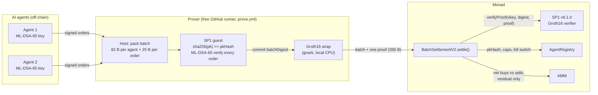

# pq-agent-batch

[](https://github.com/EmpowerTours/pq-agent-batch/actions/workflows/ci.yml)
[](LICENSE)

**Post-quantum AI-agent orders, settled in batches on Monad for about 13.8k gas each.** Each AI agent signs its trade orders with **ML-DSA-65** (FIPS 204, post-quantum). An **SP1** zkVM guest checks every signature in a batch and outputs one 32-byte digest. That run is wrapped into a single **Groth16** proof. On Monad, `BatchSettlementV2` verifies the one proof, applies the agent registry (keys, caps, nonces, kill switch), nets buys against sells, and sends only the residual to an AMM. A 100-order batch settled on a Monad devnet for **13,799 gas per order**. Verifying one ML-DSA-signed order on its own on Monad mainnet costs **1,192,307 gas**, so batching is **86× cheaper**. The proofs were made on free GitHub runners with no prover network.

It builds on [EmpowerTours/quantum-portfolio](https://github.com/EmpowerTours/quantum-portfolio), which proves one order at a time and is live on Monad mainnet. This repo is the batched version.

> **Status: research prototype, devnet only, not audited.** All keys in this repo are deterministic **TEST** keys derived from public seeds. See [Security notes and limitations](#security-notes-and-known-limitations).

## Architecture



- **Signed message** (133 B per order): order tag, chain id, settlement address, agent id, nonce, expiry, model hash, order. A signature cannot be replayed on another chain, against another contract, at another nonce, or for another model.
- **Public output of the proof:** `batchDigest = keccak256(abi.encode(BATCH_TAG_V2, chainid, settlement, batchId, keccak256(batch)))`. The contract recomputes it from calldata, so any change to the batch, the batch id, the chain or the contract address fails verification.
- **Replay protection:** per-agent nonces. Each agent group must start above that agent's `lastNonce`, and settling advances it.

### Batch format (v2)
```
batch := group+                                   (no trailing bytes)
group := agentId u32 | count u16 | firstNonce u64 | expiry u32 | pkHash b32 | modelHash b32   (82 B)
         order[count]
order := flags u8 (bit0 = buyBase) | amountIn u96 | minAmountOut u96                          (25 B)
signed msg (133 B) = keccak("EmpowerTours.AgentOrder.v2") | chainid u64 | settlement | agentId u32 |
                     nonce u64 (= firstNonce + j) | expiry u32 | modelHash | order
digest = keccak256(abi.encode(keccak("EmpowerTours.AgentBatch.v2"), chainid, settlement, batchId, keccak256(batch)))
```

## Results

### Live settlement of real proofs (local Monad devnet "Solonet", chain 20143)
Two real SP1 Groth16 proofs from the `prove` workflow were settled one after the other on one deployment, using the **real** SP1 v6.1.0 Groth16 verifier. Each tx was sent with gas limit = `eth_estimateGas`, because Monad charges the gas limit. Raw data: [`results/solonet/settlements.json`](results/solonet/settlements.json).

| Batch | Orders | Gas (charged) | Gas per order | vs one mainnet attestation per order | Tx (Solonet) |
|---|---|---|---|---|---|
| 1 | 10 | 1,315,406 | 131,541 | 9.1× cheaper | `0x283d9402524657fd60ede01e33ec7a5993c9f1ea2132b98caf382a5549256431` |
| 2 | 100 | 1,379,924 | **13,799** | **86.4× cheaper** | `0x7c4f54d8f09abd5d9e4fa4b50aeccb4d72d3c9cb7787b04a0e5c10c6bb740c28` |

The baseline is 1,192,307 gas: the gas used by quantum-portfolio's Groth16 attestation of **one** ML-DSA-65 signed order on Monad mainnet ([`0x4cc8290b…c5e4`](https://monadscan.com/tx/0x4cc8290b5338b388750b7ea3b00ae47ebd0af86a9a5d38f1096e1337f70dc5e4)). That figure covers the proof check only, not the swap.

Where the gas goes at N=100 (from `callTracer` on the live tx):

| Component | Gas | Share |
|---|---|---|
| Groth16 proof check (SP1 verifier call) | 1,063,693 | 77.1% |
| Settlement logic (decode, netting, nonces, balances; includes the ~12k slack in `eth_estimateGas`) | 141,206 | 10.2% |
| AMM (one residual swap + token transfer) | 91,611 | 6.6% |
| Registry reads (2 agents) | 34,602 | 2.5% |
| Calldata (3,236 B) | 27,812 | 2.0% |
| Intrinsic | 21,000 | 1.5% |

Everything except the proof check comes to **3,162 gas per order** at N=100. The proof check is a fixed cost, so the cost per order keeps falling as N grows.

### Proving on free GitHub runners
`SP1_PROVER=cpu` with a local gnark Groth16 wrap, on `ubuntu-latest` (16 GB RAM, plus 32 GB swap added by the workflow). No prover network and no credentials. Raw data: [`results/proving.json`](results/proving.json).

| N | Prove wall time | Peak RSS | Run |
|---|---|---|---|
| 10 | 46 min 50 s | 14.70 GiB | [38787797233](https://github.com/EmpowerTours/pq-agent-batch/actions/runs/38787797233) |
| 100 | 2 h 45 min | 14.85 GiB | [38787815547](https://github.com/EmpowerTours/pq-agent-batch/actions/runs/38787815547) |

Guest cost (SP1 6.3.1 executor): about **1.19M RISC-V cycles per order** at N ≥ 100.

### History: stand-in phase
Before any real batch proof existed, gas was measured with a **stand-in** verifier. It called the real SP1 Groth16 verifier bytecode with a real single-order proof from quantum-portfolio, so the pairing cost was the same, but it did **not** bind the batch. Measured on Solonet:

| N | v1 (ABI-encoded) gas per order | v2 (packed) gas per order, stand-in |
|---|---|---|
| 10 | 141,348 | 132,689 |
| 100 | 18,874 | 13,914 |
| 500 | 7,987 | 3,356 |

The real N=100 result (13,799) came in slightly below the stand-in (13,914), because the real verifier call costs 1,063,693 gas against 1,075,055 for the stand-in. The v1 contract and the stand-in harness have since been removed. They remain in git history up to commit [`361d5ec`](https://github.com/EmpowerTours/pq-agent-batch/tree/361d5ec). All raw rows are kept in [`results/history/gas-measurements.jsonl`](results/history/gas-measurements.jsonl). The values above 100 orders come from the stand-in phase and have not been re-measured with real proofs.

## Repository layout
| Path | What |
|---|---|
| `zk-batch/program` | SP1 guest: parses the packed batch, checks `sha256(pk) == pkHash` once per agent, verifies every ML-DSA-65 signature, and commits `abi.encode(batchDigest)`. |
| `zk-batch/lib` | Packed format, signed-message builder and digest. Matches the Solidity byte for byte, with unit tests. |
| `zk-batch/script` | Host: derives 2 deterministic TEST keys, builds and signs a batch, then `--execute` (cycle count) or `--prove` (Groth16 plus fixture JSON). Also `vkey`. |
| `zk-batch/vendor/keccak` | keccak crate patched to use SP1's keccak precompile (MIT/Apache-2.0, upstream licences included). |
| `contracts/src/BatchSettlementV2.sol` | Settlement: one proof per batch, packed calldata, nonce replay protection, one storage slot per agent, netting against the AMM. |
| `contracts/src/AgentRegistry.sol` | Agents with ML-DSA key commitments, stake, per-batch caps, kill switch, admin and guardian roles. |
| `contracts/src/dex/` | MiniAMM and MockToken (testnet only), from quantum-portfolio. |
| `contracts/bytecode/` | SP1 v6.1.0 Groth16 verifier bytecode, byte-identical to Succinct's Monad mainnet deployment ([provenance](contracts/bytecode/README.md)). |
| `contracts/test/` | 66 forge tests (see below). `helpers/HashBoundMockVerifier.sol` is a test-only mock and **must not be deployed**. |
| `contracts/script/DeploySolonet.s.sol` | Deploys verifier (optional), pool (optional), registry and settlement, registers the TEST agents and funds them. |
| `contracts/script/settle_proof.py` | Settles a prove-workflow fixture on a node after pre-flight checks. |
| `results/` | Real proof fixtures, settlement receipts, proving stats, raw gas history ([index](results/README.md)). |

## Quickstart

### 1. Contract tests (includes verifying the two real proofs)
```bash
cd contracts
forge install foundry-rs/forge-std@v1.16.1 --shallow --no-git
forge install OpenZeppelin/openzeppelin-contracts@v5.6.1 --shallow --no-git
forge test
```
66 tests:
- `BatchSettlementV2.t.sol` (29): happy path, netting, binding, malformed-input and fuzz tests, plus a parity fixture from the Rust guest.
- `GasProbeV2.t.sol` (30): re-runs those 29 plus a local gas probe.
- `RealGroth16Settle.t.sol` (7): settles the committed **real** N=10 and N=100 proofs against the real verifier bytecode, and checks that replay, tampered orders, a wrong batch id, a wrong chain and a tampered proof are all rejected.

### 2. Rust tests and guest execution
```bash
cd zk-batch
cargo test -p agent-batch-lib --release        # packed-format parser tests
# Guest build needs protoc and the SP1 toolchain: curl -L https://sp1up.succinct.xyz | bash && sp1up --version v6.3.1
cargo build --release
./target/release/batch --execute -n 100        # cycle count
./target/release/batch --execute -n 4 --tamper # must be rejected (exit 2)
```

### 3. Generate a real Groth16 proof (GitHub Actions, free runner)
```bash
gh workflow run prove.yml -R EmpowerTours/pq-agent-batch \
  -f n=10 -f settlement=<settlement address> -f chain_id=20143 -f batch_id=1 -f nonce_base=0
```
The proof is bound to `settlement`, `chain_id` and `batch_id`. Choose `nonce_base` so that both agents start above their on-chain `lastNonce`: agent 1 starts at `nonce_base+1` and agent 2 at `nonce_base+ceil(N/2)+1`. The artifact `groth16-batch-n<N>-b<batch_id>` contains `groth16-batch-fixture.json`, `proof.bin`, `vkey.txt` and `prove.log`. Expect ~47 min for N=10 and ~2 h 45 min for N=100.

### 4. Settle it on a local Monad devnet (Solonet)
```bash
cd contracts
# deploys the verifier, a test pool, the registry and the settlement; registers and funds TEST agents 1 and 2
BATCH_VKEY=$(cat path/to/vkey.txt) forge script script/DeploySolonet.s.sol \
  --rpc-url http://localhost:8080 --private-key "$(cat "$KEY_FILE")" --broadcast --slow --gas-estimate-multiplier 300
# ...run step 3 with the printed SETTLEMENT address, download the artifact, then:
pip install eth-abi eth-utils eth-account
SETTLEMENT=0x... KEY_FILE=/path/to/devnet.key python3 script/settle_proof.py path/to/groth16-batch-fixture.json --dry-run
SETTLEMENT=0x... KEY_FILE=/path/to/devnet.key python3 script/settle_proof.py path/to/groth16-batch-fixture.json
```
Before sending, `settle_proof.py` checks the chain id, the bound settlement address, contract vkey == proof vkey, contract digest == proof digest == public values, and the nonce preconditions. It then sends with gas limit = `eth_estimateGas` and appends the receipt and trace breakdown to `results/solonet/settlements.jsonl`. Settle batches in nonce order. The devnet key is never committed.

## Security notes and known limitations
- **Testnet/devnet only, unaudited.** Do not use with real funds. MockToken and MiniAMM are test contracts.
- **The Monad transaction itself is still ECDSA.** ML-DSA protects the *agent's authorisation of each order*. The relayer submitting `settle()` uses a normal secp256k1 account. Anyone can relay, and a valid proof is all that is needed, so a compromised relayer cannot forge or alter orders. It can only delay or censor them.
- **Expiry and model hash are per agent group.** Within one batch, all of an agent's orders share one expiry and one model hash. Different expiries or models need separate batches.
- **vkey pinning.** `batchProgramVKey` is immutable. Any change to the guest (or to the toolchain that builds it) changes the vkey, and requires a new settlement deployment and new proofs. `settle_proof.py` catches a mismatch before sending.
- **Replay.** Per-agent nonces only; there is no batch nullifier. `batchId` is bound into the digest but is not required to be unique on chain. Batches must be settled in nonce order.
- **Throughput of free runners.** About **200 orders** is the practical limit of one free 6-hour GitHub job. This is an estimate, from a linear fit to the two runs: ~34 min fixed plus ~1.3 min per order, plus ~10 min of setup and build. Memory peaked at ~14.9 GiB at both N=10 and N=100 (16 GB plus swap), so time is the limit, not RAM.
- **Shared decoder.** The contract and the guest decode the packed format with identical strict rules, covered by malformed-input tests on both sides, a no-panic fuzz test and a parity fixture.
- **TEST keys.** The ML-DSA keys come from public seeds in `zk-batch/script`, so anyone can sign as these agents. Never register them on a real deployment.

## Roadmap
- Deploy to Monad testnet and then mainnet, reusing Succinct's deployed SP1 v6.1.0 verifier `0xb69f2584…f4e2`.
- Larger batches beyond one runner: split the batch across runners and aggregate with SP1 recursion, or use a self-hosted GPU prover.
- Per-order expiry and model hash, if it pays for its calldata.
- Real liquidity: route the residual to a live Monad DEX, as quantum-portfolio does with Uniswap v3.
- Relayer and watcher service: collect signed orders, trigger proving, and settle automatically.
- A post-quantum transaction path for the relayer account, once Monad supports account abstraction or PQ signatures.
- External audit before any mainnet value.

## License
MIT, matching quantum-portfolio. `zk-batch/vendor/keccak` keeps its upstream MIT/Apache-2.0 licences. The SP1 verifier bytecode in `contracts/bytecode/` is Succinct's MIT-licensed `sp1-contracts`.
